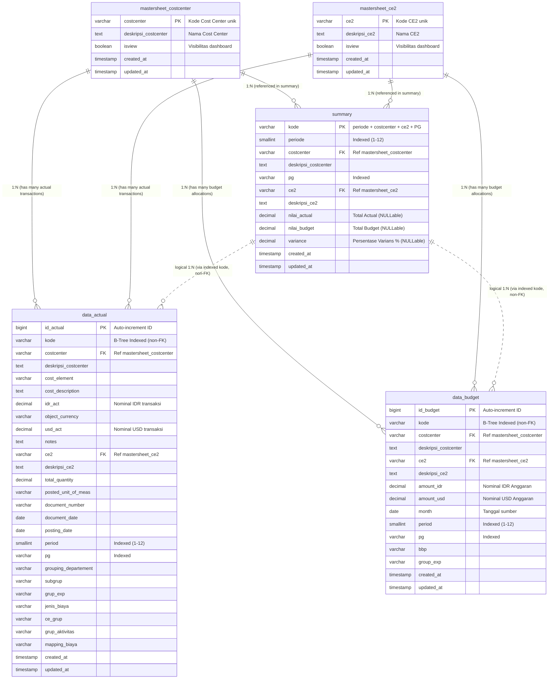

# Dokumentasi & Spesifikasi Struktur Skema Database OPEX GGP

Dokumen ini merupakan spesifikasi arsitektur dan struktur database terpadu untuk modul **Dashboard OPEX (*Operating Expenditure*) Great Giant Foods (GGP)**, dibangun menggunakan **PostgreSQL** dan **Prisma ORM**. Dokumen ini menyatukan seluruh kebutuhan bisnis, kamus data struktur tabel, aturan pengolahan transaksi, relasi entitas, query agregasi, hingga kode schema DDL dan Prisma.

---

## 1. Konteks Proyek & Analisis Kebutuhan Bisnis

Sistem dirancang untuk memantau, menganalisis, dan membandingkan realisasi pengeluaran operasional (**Actual**) terhadap anggaran (**Budget**) secara efisien, akurat, dan cepat melalui visualisasi dashboard.

### Karakteristik & Tantangan Data OPEX:
1. **Multi-Granularitas Data Sumber**:
   - **Data Actual**: Berisi data transaksi historis operasional yang sangat detail per nomor dokumen ERP/SAP (`document_number`), tanggal transaksi (`posting_date`), material, dan akun biaya. Satu periode dan Cost Center dapat memiliki ratusan hingga ribuan baris transaksi.
   - **Data Budget**: Berisi plafon anggaran operasional tahunan yang dipecah per bulan (`month`) dan Cost Element 2 (`ce2`).
   - **Pencegahan Multiplication Error**: Karena perbedaan granularitas ini, **dilarang keras melakukan direct table join** (`data_actual JOIN data_budget ON kode`) sebelum dilakukan agregasi independen per kode, karena akan memicu *Cartesian product* (penggelembungan nilai akibat multiplikasi baris transaksi).
2. **Kunci Pemersatu Agregasi (`kode`)**:
   - Perbandingan antara realisasi dan anggaran disatukan melalui kunci unik `kode` dengan rumus:
     $$\text{kode} = \text{periode} + \text{costcenter} + \text{ce2} + \text{PG}$$
   - Kode ini merepresentasikan entitas biaya operasional pada subgrup dan periode tertentu.
3. **Preservasi Ketat Nilai NULL vs Nilai Nol (0.00)**:
   - Data yang tidak ada transaksi (misal: ada alokasi budget tetapi belum ada realisasi aktual) **wajib bernilai `NULL`** dan dirender pada dashboard sebagai tanda `-`.
   - Data pengeluaran yang tercatat bernilai Rp 0 **wajib disimpan sebagai `0.00`** dan dirender sebagai angka `0`.
4. **Visibilitas vs Integritas Data**:
   - Kolom `isview` pada master Cost Center dan CE2 hanya mengatur apakah item tersebut ditampilkan pada filter/kartu dashboard, tanpa menghapus data transaksi historis dari database.

---

## 2. Struktur Lengkap Database (Kamus Data)

Database terdiri dari **5 tabel utama** pada schema PostgreSQL `opex`:

```
┌─────────────────────────────────────────────────────────┐
│                    SCHEMA: opex                         │
├──────────────────────────┬──────────────────────────────┤
│ 1. mastersheet_costcenter│ Tabel Master Cost Center     │
│ 2. mastersheet_ce2       │ Tabel Master Cost Element 2  │
│ 3. data_actual           │ Transaksi Pengeluaran Aktual │
│ 4. data_budget           │ Alokasi Anggaran OPEX        │
│ 5. summary               │ Ringkasan Agregasi & Varians │
└──────────────────────────┴──────────────────────────────┘
```

---

### A. Tabel Master: `mastersheet_costcenter`
Menyimpan daftar master Cost Center unik yang diperoleh dari kolom Summary file Excel sumber.

| No | Nama Kolom | Tipe PostgreSQL | Tipe Prisma | Constraint | Nullable | Default | Keterangan & Aturan Bisnis |
|:---|:---|:---|:---|:---|:---|:---|:---|
| 1 | `costcenter` | `VARCHAR(50)` | `String` | `PRIMARY KEY` | No | - | Kode unik Cost Center (unik, tidak boleh null/duplikat) |
| 2 | `deskripsi_costcenter` | `TEXT` | `String?` | - | Yes | `NULL` | Nama/deskripsi lengkap Cost Center |
| 3 | `isview` | `BOOLEAN` | `Boolean` | - | No | `true` | Kontrol visibilitas dashboard (bukan untuk hapus data) |
| 4 | `created_at` | `TIMESTAMP(3)` | `DateTime` | - | No | `CURRENT_TIMESTAMP` | Waktu data pertama kali dibuat |
| 5 | `updated_at` | `TIMESTAMP(3)` | `DateTime` | - | No | - | Waktu data terakhir diperbarui |

---

### B. Tabel Master: `mastersheet_ce2`
Menyimpan daftar master Cost Element 2 (CE2) unik dari kolom Summary file Excel sumber.

| No | Nama Kolom | Tipe PostgreSQL | Tipe Prisma | Constraint | Nullable | Default | Keterangan & Aturan Bisnis |
|:---|:---|:---|:---|:---|:---|:---|:---|
| 1 | `ce2` | `VARCHAR(50)` | `String` | `PRIMARY KEY` | No | - | Kode unik Cost Element 2 (unik, tidak boleh null) |
| 2 | `deskripsi_ce2` | `TEXT` | `String?` | - | Yes | `NULL` | Nama/deskripsi lengkap Cost Element 2 |
| 3 | `isview` | `BOOLEAN` | `Boolean` | - | No | `true` | Kontrol visibilitas dashboard |
| 4 | `created_at` | `TIMESTAMP(3)` | `DateTime` | - | No | `CURRENT_TIMESTAMP` | Waktu data pertama kali dibuat |
| 5 | `updated_at` | `TIMESTAMP(3)` | `DateTime` | - | No | - | Waktu data terakhir diperbarui |

---

### C. Tabel Transaksi: `data_actual`
Menyimpan seluruh transaksi pengeluaran aktual dari lembar kerja Excel sumber.

| No | Nama Kolom | Tipe PostgreSQL | Tipe Prisma | Constraint / Index | Nullable | Keterangan Sumber Excel & Aturan |
|:---|:---|:---|:---|:---|:---|:---|
| 1 | `id_actual` | `BIGSERIAL` | `BigInt` | `PRIMARY KEY` | No | Auto-increment identifier unik transaksi |
| 2 | `kode` | `VARCHAR(100)` | `String` | `INDEX` | No | Kode gabungan (`periode + costcenter + ce2 + PG`) |
| 3 | `costcenter` | `VARCHAR(50)` | `String?` | `INDEX, FK -> mastersheet_costcenter` | Yes | Kode Cost Center transaksi |
| 4 | `deskripsi_costcenter` | `TEXT` | `String?` | - | Yes | Deskripsi Cost Center (denormalized sumber) |
| 5 | `cost_element` | `VARCHAR(50)` | `String?` | - | Yes | Kode Cost Element akun |
| 6 | `cost_description` | `TEXT` | `String?` | - | Yes | Deskripsi Cost Element akun |
| 7 | `idr_act` | `DECIMAL(18, 2)` | `Decimal?` | - | Yes | Nilai transaksi IDR (kolom Excel `IDR-Act`) |
| 8 | `object_currency` | `VARCHAR(10)` | `String?` | - | Yes | Mata uang transaksi (`IDR` / `USD`) |
| 9 | `usd_act` | `DECIMAL(18, 2)` | `Decimal?` | - | Yes | Nilai transaksi USD (kolom Excel `USD-Act`) |
| 10 | `notes` | `TEXT` | `String?` | - | Yes | Catatan/keterangan detail transaksi |
| 11 | `ce2` | `VARCHAR(50)` | `String?` | `INDEX, FK -> mastersheet_ce2` | Yes | Kode Cost Element 2 |
| 12 | `deskripsi_ce2` | `TEXT` | `String?` | - | Yes | Deskripsi Cost Element 2 |
| 13 | `total_quantity` | `DECIMAL(15, 4)` | `Decimal?` | - | Yes | Kuantitas barang/pekerjaan yang terealisasi |
| 14 | `posted_unit_of_meas` | `VARCHAR(20)` | `String?` | - | Yes | Satuan pengukuran (Unit of Measure) |
| 15 | `document_number` | `VARCHAR(50)` | `String?` | - | Yes | Nomor referensi dokumen SAP / ERP |
| 16 | `document_date` | `DATE` | `DateTime?` | - | Yes | Tanggal dokumen dibuat |
| 17 | `posting_date` | `DATE` | `DateTime?` | - | Yes | Tanggal posting akuntansi |
| 18 | `period` | `SMALLINT` | `Int?` | `INDEX` | Yes | Periode dinormalisasi menjadi angka bulan 1–12 |
| 19 | `pg` | `VARCHAR(20)` | `String?` | `INDEX` | Yes | Purchasing Group / Plantation Group |
| 20 | `grouping_departement` | `VARCHAR(100)` | `String?` | - | Yes | Klasifikasi grouping departemen |
| 21 | `subgrup` | `VARCHAR(100)` | `String?` | - | Yes | Klasifikasi sub-grup |
| 22 | `grup_exp` | `VARCHAR(100)` | `String?` | - | Yes | Klasifikasi grup pengeluaran (expense group) |
| 23 | `jenis_biaya` | `VARCHAR(100)` | `String?` | - | Yes | Klasifikasi jenis biaya operasional |
| 24 | `ce_grup` | `VARCHAR(100)` | `String?` | - | Yes | Klasifikasi grup Cost Element |
| 25 | `grup_aktivitas` | `VARCHAR(100)` | `String?` | - | Yes | Klasifikasi grup aktivitas operasional |
| 26 | `mapping_biaya` | `VARCHAR(100)` | `String?` | - | Yes | Pemetaan biaya internal GGP |
| 27 | `created_at` | `TIMESTAMP(3)` | `DateTime` | - | No | Default `CURRENT_TIMESTAMP` |
| 28 | `updated_at` | `TIMESTAMP(3)` | `DateTime` | - | No | Waktu pembaruan data |

---

### D. Tabel Transaksi: `data_budget`
Menyimpan data alokasi anggaran OPEX dari lembar kerja Excel sumber.

| No | Nama Kolom | Tipe PostgreSQL | Tipe Prisma | Constraint / Index | Nullable | Keterangan Sumber Excel & Aturan |
|:---|:---|:---|:---|:---|:---|:---|
| 1 | `id_budget` | `BIGSERIAL` | `BigInt` | `PRIMARY KEY` | No | Auto-increment identifier unik budget |
| 2 | `kode` | `VARCHAR(100)` | `String` | `INDEX` | No | Kode gabungan (`periode + costcenter + ce2 + PG`) |
| 3 | `costcenter` | `VARCHAR(50)` | `String?` | `INDEX, FK -> mastersheet_costcenter` | Yes | Kode Cost Center anggaran |
| 4 | `deskripsi_costcenter` | `TEXT` | `String?` | - | Yes | Deskripsi Cost Center |
| 5 | `ce2` | `VARCHAR(50)` | `String?` | `INDEX, FK -> mastersheet_ce2` | Yes | Kode Cost Element 2 |
| 6 | `deskripsi_ce2` | `TEXT` | `String?` | - | Yes | Deskripsi Cost Element 2 |
| 7 | `amount_idr` | `DECIMAL(18, 2)` | `Decimal?` | - | Yes | Nilai anggaran IDR (tipe uang presisi tinggi) |
| 8 | `amount_usd` | `DECIMAL(18, 2)` | `Decimal?` | - | Yes | Nilai anggaran USD |
| 9 | `month` | `DATE` | `DateTime?` | - | Yes | Periode tanggal dari Excel sumber |
| 10 | `period` | `SMALLINT` | `Int?` | `INDEX` | Yes | Angka bulan 1–12 hasil konversi dari `month` |
| 11 | `pg` | `VARCHAR(50)` | `String?` | `INDEX` | Yes | Plantation Group / PG (sumber mapping / pertanyaan terbuka) |
| 12 | `bbp` | `VARCHAR(50)` | `String?` | - | Yes | Kode BBP |
| 13 | `group_exp` | `VARCHAR(100)` | `String?` | - | Yes | Klasifikasi grup pengeluaran |
| 14 | `created_at` | `TIMESTAMP(3)` | `DateTime` | - | No | Default `CURRENT_TIMESTAMP` |
| 15 | `updated_at` | `TIMESTAMP(3)` | `DateTime` | - | No | Waktu pembaruan data |

---

### E. Tabel Agregasi: `summary`
Menyajikan ringkasan data Actual dan Budget per kode unik beserta persentase varians.

| No | Nama Kolom | Tipe PostgreSQL | Tipe Prisma | Constraint / Index | Nullable | Keterangan & Formula |
|:---|:---|:---|:---|:---|:---|:---|
| 1 | `kode` | `VARCHAR(100)` | `String` | `PRIMARY KEY` | No | Kunci unik gabungan (`periode + costcenter + ce2 + PG`) |
| 2 | `periode` | `SMALLINT` | `Int` | `INDEX` | No | Angka bulan 1–12 |
| 3 | `costcenter` | `VARCHAR(50)` | `String?` | `INDEX, FK -> mastersheet_costcenter` | Yes | Kode Cost Center |
| 4 | `deskripsi_costcenter` | `TEXT` | `String?` | - | Yes | Deskripsi Cost Center |
| 5 | `pg` | `VARCHAR(50)` | `String?` | `INDEX` | Yes | Plantation Group / Purchasing Group |
| 6 | `ce2` | `VARCHAR(50)` | `String?` | `INDEX, FK -> mastersheet_ce2` | Yes | Kode Cost Element 2 |
| 7 | `deskripsi_ce2` | `TEXT` | `String?` | - | Yes | Deskripsi Cost Element 2 |
| 8 | `nilai_actual` | `DECIMAL(18, 2)` | `Decimal?` | - | Yes | Total `idr_act` (bernilai `NULL` jika tidak ada transaksi) |
| 9 | `nilai_budget` | `DECIMAL(18, 2)` | `Decimal?` | - | Yes | Total `amount_idr` (bernilai `NULL` jika tidak ada budget) |
| 10 | `variance` | `DECIMAL(10, 2)` | `Decimal?` | - | Yes | **Varians (%)**: `((nilai_actual - nilai_budget)/nilai_budget)*100` (`NULL` jika budget 0/NULL) |
| 11 | `created_at` | `TIMESTAMP(3)` | `DateTime` | - | No | Default `CURRENT_TIMESTAMP` |
| 12 | `updated_at` | `TIMESTAMP(3)` | `DateTime` | - | No | Waktu refresh summary |

---

## 3. Entity Relationship Diagram (ERD)

Berikut adalah diagram relasi antartabel database OPEX:



---

## 4. Penjelasan Relasi & Evaluasi Foreign Key

### Kardinalitas Antartabel:
1. **`mastersheet_costcenter` (1) $\rightarrow$ `data_actual` (N)**: Satu Cost Center menaungi banyak baris transaksi pengeluaran actual sepanjang tahun.
2. **`mastersheet_costcenter` (1) $\rightarrow$ `data_budget` (N)**: Satu Cost Center memiliki banyak alokasi anggaran bulanan per Cost Element.
3. **`mastersheet_costcenter` (1) $\rightarrow$ `summary` (N)**: Satu Cost Center muncul pada banyak baris summary untuk berbagai periode, CE2, dan PG.
4. **`mastersheet_ce2` (1) $\rightarrow$ `data_actual` (N)**: Satu Cost Element 2 digunakan pada banyak transaksi pengeluaran.
5. **`mastersheet_ce2` (1) $\rightarrow$ `data_budget` (N)**: Satu Cost Element 2 dialokasikan pada berbagai Cost Center dan bulan.
6. **`mastersheet_ce2` (1) $\rightarrow$ `summary` (N)**: Satu Cost Element 2 muncul pada banyak baris summary.

### Evaluasi Kritis: Foreign Key pada Kolom `kode`
- **Pertanyaan Desain**: Apakah kolom `kode` pada `data_actual` dan `data_budget` harus dijadikan *Physical Foreign Key Constraint* (`REFERENCES summary(kode)`)?
- **Keputusan Arsitektur**: **TIDAK MENGGUNAKAN Physical Foreign Key pada `kode`**.
  - **Masalah Urutan Ingesti (*Chicken-and-Egg Dilemma*)**:
    Data transaksi `data_actual` dan `data_budget` diimpor terlebih dahulu dari file Excel. Tabel `summary` baru dapat dihitung dan di-insert **setelah** seluruh data transaksi tersedia. Jika `kode` pada tabel transaksi adalah foreign key ke `summary`, maka operasi *insert transaksi akan gagal total* (menimbulkan *Foreign Key Violation*) karena record di `summary` belum terbentuk.
  - **Efisiensi Batch Insert**: Foreign key validation pada ratusan ribu baris transaksi selama proses impor Excel akan membebani database dan memperlambat proses upload.
  - **Solusi yang Diterapkan**:
    Kolom `kode` pada `data_actual` dan `data_budget` diberi **B-Tree Index (`@@index([kode])`)**. Relasi logis tetap solid, query agregasi berjalan instan (< 10ms), dan alur impor data berjalan lancar tanpa deadlock/constraint lock.

---

## 5. Analisis Komparatif: Tabel Fisik vs Database View

| Aspek Perbandingan | Database View (`CREATE VIEW`) | Tabel Fisik `summary` (**Rekomendasi Terpilih**) |
| :--- | :--- | :--- |
| **Kecepatan Query Dashboard** | Lambat (harus melakukan `SUM`, `GROUP BY`, dan `FULL OUTER JOIN` setiap kali user membuka dashboard). | **Sangat Cepat (< 30ms)** karena data telah siap dibaca (*pre-aggregated*). |
| **Beban Server CPU/Memory** | Membebani database saat banyak user mengakses filter bersamaan. | **Sangat Ringan**, hanya memerlukan pembacaan berindeks (*Index Scan*). |
| **Dukungan Indexing Tambahan** | Sangat terbatas (tidak bisa diindeks langsung tanpa Materialized View). | **Penuh** (bisa diberi indeks pada `periode`, `costcenter`, `ce2`, dan `pg`). |
| **Kesesuaian Karakter Data** | Cocok untuk data transaksional realtime (per detik/menit). | **Sangat Cocok untuk Data OPEX/Akuntansi** yang diperbarui secara batch bulanan/tahunan via Excel. |

> [!TIP]
> **Rekomendasi Final**: Gunakan **Tabel Fisik `summary`**. Setiap kali file Excel baru diunggah oleh admin, tabel `summary` diregenerasi otomatis di dalam transaksi atomik (`prisma.$transaction`). Pengguna dashboard akan selalu merasakan navigasi yang responsif tanpa beban agregasi berat.

---

## 6. Aturan Pembentukan `kode` & Pertanyaan Terbuka PG

Rumus pembentukan kode resmi:
$$\text{kode} = \text{TRIM}(\text{periode}) + \text{TRIM}(\text{costcenter}) + \text{TRIM}(\text{ce2}) + \text{TRIM}(\text{PG})$$

### Aturan Normalisasi:
1. **Pembersihan String & Huruf Kapital**:
   - Seluruh komponen di-`TRIM()` untuk membuang spasi kosong atau karakter tak terlihat dari Excel.
   - `costcenter`, `ce2`, dan `PG` dikonversi ke **UPPERCASE** (`toUpperCase()`) agar tidak terjadi ketidakcocokan karena perbedaan huruf kapital (`pg1` vs `PG1`).
2. **Format Periode**:
   - Periode adalah angka integer 1–12 tanpa leading zero (`1`, `2`, ..., `12`).
   - Contoh hasil:
     - Periode 1, Cost Center `CC100`, CE2 `CE01`, PG `PG1` $\rightarrow$ `1CC100CE01PG1`
     - Periode 12, Cost Center `CC100`, CE2 `CE01`, PG `PG1` $\rightarrow$ `12CC100CE01PG1`

---

### ⚠️ Pertanyaan Terbuka: Sumber Nilai `PG` pada `data_budget` & Solusinya

> [!IMPORTANT]
> **Identifikasi Masalah**:
> - Kolom `PG` (Plantation Group / Purchasing Group) tercantum pada file transaksi `data_actual`, namun **belum tercantum pada daftar kolom file `data_budget`**.
> - **Dampak Kritis terhadap Agregasi**:
>   Karena rumus `kode` wajib menyertakan `PG`, jika pada saat pembentukan kode Budget nilai `PG` kosong (misalnya menghasilkan `1CC100CE01`), maka kode Budget **tidak akan pernah cocok (*mismatch*)** dengan kode Actual (`1CC100CE01PG1`).
>   Akibatnya, data Actual dan Budget akan terpisah menjadi **dua baris berbeda** pada tabel `summary`, dan nilai `variance` tidak dapat diperbandingkan.

**3 Opsi Rekomendasi Resolusi Desain**:
1. **Opsi 1 (Mapping Otomatis 1 Cost Center = 1 PG)**:
   Jika dalam struktur organisasi GGP setiap Cost Center secara unik hanya bernaung di bawah satu PG tertentu, sistem dapat memetakan `PG` pada `data_budget` secara otomatis berdasarkan `costcenter` saat proses impor.
2. **Opsi 2 (Penambahan Kolom PG di Template Budget Excel)**:
   Menginformasikan kepada bagian Finance/Budgeting untuk menambahkan kolom `PG` pada template file Excel Budget.
3. **Opsi 3 (Ekstraksi dari Kolom `BBP` / `group_exp`)**:
   Jika kolom `BBP` (misal `BBP-PG1-002`) memuat informasi PG, sistem dapat membuat aturan parsing regex untuk mengekstrak kode PG secara otomatis.

---

## 7. Logika Agregasi Summary (Full Outer Aggregation SQL)

Untuk mencegah nilai berlipat ganda (*multiplication error*), agregasi harus dilakukan secara terpisah pada masing-masing tabel sebelum digabungkan dengan `FULL OUTER JOIN`:

```sql
WITH agg_actual AS (
    SELECT 
        kode,
        MAX(period) AS periode,
        MAX(costcenter) AS costcenter,
        MAX(deskripsi_costcenter) AS deskripsi_costcenter,
        MAX(pg) AS pg,
        MAX(ce2) AS ce2,
        MAX(deskripsi_ce2) AS deskripsi_ce2,
        -- Jika seluruh baris bernilai NULL, SUM akan tetap menghasilkan NULL
        SUM(idr_act) AS total_actual
    FROM opex.data_actual
    WHERE kode IS NOT NULL AND kode != ''
    GROUP BY kode
),
agg_budget AS (
    SELECT 
        kode,
        MAX(period) AS periode,
        MAX(costcenter) AS costcenter,
        MAX(deskripsi_costcenter) AS deskripsi_costcenter,
        MAX(pg) AS pg,
        MAX(ce2) AS ce2,
        MAX(deskripsi_ce2) AS deskripsi_ce2,
        -- Jika seluruh baris bernilai NULL, SUM akan tetap menghasilkan NULL
        SUM(amount_idr) AS total_budget
    FROM opex.data_budget
    WHERE kode IS NOT NULL AND kode != ''
    GROUP BY kode
)
SELECT 
    COALESCE(a.kode, b.kode) AS kode,
    COALESCE(a.periode, b.periode) AS periode,
    COALESCE(a.costcenter, b.costcenter) AS costcenter,
    COALESCE(a.deskripsi_costcenter, b.deskripsi_costcenter) AS deskripsi_costcenter,
    COALESCE(a.pg, b.pg) AS pg,
    COALESCE(a.ce2, b.ce2) AS ce2,
    COALESCE(a.deskripsi_ce2, b.deskripsi_ce2) AS deskripsi_ce2,
    a.total_actual AS nilai_actual,
    b.total_budget AS nilai_budget,
    -- Rumus Varians (%): ((nilai_actual - nilai_budget) / nilai_budget) * 100
    -- Dilengkapi proteksi Division by Zero & Penanganan NULL
    CASE 
        WHEN b.total_budget IS NULL OR b.total_budget = 0 OR a.total_actual IS NULL THEN NULL
        ELSE ROUND(((a.total_actual - b.total_budget) / b.total_budget) * 100, 2)
    END AS variance
FROM agg_actual a
FULL OUTER JOIN agg_budget b ON a.kode = b.kode;
```

### Matriks Pengujian Kasus Khusus:

| Skenario Transaksi | Nilai Actual | Nilai Budget | `nilai_actual` | `nilai_budget` | `variance` | Tampilan Dashboard |
|:---|:---|:---|:---|:---|:---|:---|
| **Kasus 1**: Ada transaksi actual, belum ada budget | Rp 5.000.000 | (Tidak Ada Baris) | `5000000.00` | `NULL` | `NULL` | Actual: 5.000.000 \| Budget: `-` \| Varians: `-` |
| **Kasus 2**: Ada anggaran budget, belum ada realisasi | (Tidak Ada Baris) | Rp 10.000.000 | `NULL` | `10000000.00` | `NULL` | Actual: `-` \| Budget: 10.000.000 \| Varians: `-` |
| **Kasus 3**: Transaksi actual tercatat Rp 0 | Rp 0.00 | Rp 4.000.000 | `0.00` | `4000000.00` | `-100.00` | Actual: 0 \| Budget: 4.000.000 \| Varians: `-100.00%` |
| **Kasus 4**: Budget bernilai Rp 0 | Rp 2.500.000 | Rp 0.00 | `2500000.00` | `0.00` | `NULL` | Actual: 2.500.000 \| Budget: 0 \| Varians: `-` *(aman div/0)* |
| **Kasus 5**: Realisasi melebihi budget (*over-budget*) | Rp 12.000.000 | Rp 10.000.000 | `12000000.00` | `10000000.00` | `+20.00` | Actual: 12.000.000 \| Budget: 10.000.000 \| Varians: `+20.00%` |
| **Kasus 6**: Realisasi di bawah budget (*saving*) | Rp 8.000.000 | Rp 10.000.000 | `8000000.00` | `10000000.00` | `-20.00` | Actual: 8.000.000 \| Budget: 10.000.000 \| Varians: `-20.00%` |

---

## 8. Strategi Impor Excel & Penggantian Data Tahunan (*Safe Replacement*)

Sesuai aturan bisnis, data tahunan akan di-replace setiap tahun tanpa menyisipkan nama tahun ke dalam `kode`. Untuk memastikan pembaruan data berjalan aman tanpa *downtime* atau risiko kehilangan data:

### Alur Eksekusi Transaksi Atomik:
```typescript
import { prisma } from "@/lib/prisma";

export async function replaceAnnualOpexData({
  costcenters,
  ce2List,
  actualRows,
  budgetRows,
}: ImportPayload) {
  return await prisma.$transaction(
    async (tx) => {
      // 1. Upsert Master Cost Center (Preservasi setting isview yang sudah ada)
      for (const cc of costcenters) {
        await tx.mastersheetCostcenter.upsert({
          where: { costcenter: cc.costcenter },
          create: { costcenter: cc.costcenter, deskripsiCostcenter: cc.deskripsi, isview: true },
          update: { deskripsiCostcenter: cc.deskripsi },
        });
      }

      // 2. Upsert Master CE2 (Preservasi isview)
      for (const c2 of ce2List) {
        await tx.mastersheetCe2.upsert({
          where: { ce2: c2.ce2 },
          create: { ce2: c2.ce2, deskripsiCe2: c2.deskripsi, isview: true },
          update: { deskripsiCe2: c2.deskripsi },
        });
      }

      // 3. Bersihkan data transaksi tahun berjalan secara aman
      await tx.dataActual.deleteMany({});
      await tx.dataBudget.deleteMany({});

      // 4. Batch Insert data baru
      await tx.dataActual.createMany({ data: actualRows, skipDuplicates: false });
      await tx.dataBudget.createMany({ data: budgetRows, skipDuplicates: false });

      // 5. Regenerasi Tabel Summary dari hasil agregasi
      await tx.$executeRawUnsafe(`
        TRUNCATE TABLE opex.summary;
        INSERT INTO opex.summary (
          kode, periode, costcenter, deskripsi_costcenter, pg, ce2, deskripsi_ce2,
          nilai_actual, nilai_budget, variance, created_at, updated_at
        )
        WITH agg_actual AS (
          SELECT kode, MAX(period) AS periode, MAX(costcenter) AS costcenter,
                 MAX(deskripsi_costcenter) AS deskripsi_costcenter, MAX(pg) AS pg,
                 MAX(ce2) AS ce2, MAX(deskripsi_ce2) AS deskripsi_ce2,
                 SUM(idr_act) AS total_actual
          FROM opex.data_actual WHERE kode IS NOT NULL AND kode != '' GROUP BY kode
        ),
        agg_budget AS (
          SELECT kode, MAX(period) AS periode, MAX(costcenter) AS costcenter,
                 MAX(deskripsi_costcenter) AS deskripsi_costcenter, MAX(pg) AS pg,
                 MAX(ce2) AS ce2, MAX(deskripsi_ce2) AS deskripsi_ce2,
                 SUM(amount_idr) AS total_budget
          FROM opex.data_budget WHERE kode IS NOT NULL AND kode != '' GROUP BY kode
        )
        SELECT 
          COALESCE(a.kode, b.kode),
          COALESCE(a.periode, b.periode),
          COALESCE(a.costcenter, b.costcenter),
          COALESCE(a.deskripsi_costcenter, b.deskripsi_costcenter),
          COALESCE(a.pg, b.pg),
          COALESCE(a.ce2, b.ce2),
          COALESCE(a.deskripsi_ce2, b.deskripsi_ce2),
          a.total_actual,
          b.total_budget,
          CASE 
            WHEN b.total_budget IS NULL OR b.total_budget = 0 OR a.total_actual IS NULL THEN NULL
            ELSE ROUND(((a.total_actual - b.total_budget) / b.total_budget) * 100, 2)
          END,
          NOW(), NOW()
        FROM agg_actual a
        FULL OUTER JOIN agg_budget b ON a.kode = b.kode;
      `);
    },
    { timeout: 60000 } // Menjamin timeout cukup untuk batch besar
  );
}
```

---

## 9. Rekomendasi Indeks PostgreSQL

Untuk mendukung performa tinggi pada dashboard:

```sql
-- 1. Indeks pada Tabel Summary (Filter Utama Dashboard)
CREATE INDEX idx_summary_periode ON opex.summary(periode);
CREATE INDEX idx_summary_costcenter ON opex.summary(costcenter);
CREATE INDEX idx_summary_ce2 ON opex.summary(ce2);
CREATE INDEX idx_summary_pg ON opex.summary(pg);
CREATE INDEX idx_summary_combined_filter ON opex.summary(periode, costcenter, ce2);

-- 2. Indeks pada Tabel Data Actual (Kecepatan Agregasi & Drill-Down)
CREATE INDEX idx_actual_kode ON opex.data_actual(kode);
CREATE INDEX idx_actual_period ON opex.data_actual(period);
CREATE INDEX idx_actual_costcenter ON opex.data_actual(costcenter);
CREATE INDEX idx_actual_ce2 ON opex.data_actual(ce2);
CREATE INDEX idx_actual_pg ON opex.data_actual(pg);

-- 3. Indeks pada Tabel Data Budget (Kecepatan Agregasi & Drill-Down)
CREATE INDEX idx_budget_kode ON opex.data_budget(kode);
CREATE INDEX idx_budget_period ON opex.data_budget(period);
CREATE INDEX idx_budget_costcenter ON opex.data_budget(costcenter);
CREATE INDEX idx_budget_ce2 ON opex.data_budget(ce2);
CREATE INDEX idx_budget_pg ON opex.data_budget(pg);
```

---

## 10. Implementasi PostgreSQL DDL (`CREATE TABLE`)

Berikut skrip DDL murni PostgreSQL:

```sql
CREATE SCHEMA IF NOT EXISTS opex;

-- 1. Mastersheet Cost Center
CREATE TABLE opex.mastersheet_costcenter (
    costcenter VARCHAR(50) PRIMARY KEY,
    deskripsi_costcenter TEXT,
    isview BOOLEAN NOT NULL DEFAULT TRUE,
    created_at TIMESTAMP(3) NOT NULL DEFAULT CURRENT_TIMESTAMP,
    updated_at TIMESTAMP(3) NOT NULL DEFAULT CURRENT_TIMESTAMP
);

-- 2. Mastersheet CE2
CREATE TABLE opex.mastersheet_ce2 (
    ce2 VARCHAR(50) PRIMARY KEY,
    deskripsi_ce2 TEXT,
    isview BOOLEAN NOT NULL DEFAULT TRUE,
    created_at TIMESTAMP(3) NOT NULL DEFAULT CURRENT_TIMESTAMP,
    updated_at TIMESTAMP(3) NOT NULL DEFAULT CURRENT_TIMESTAMP
);

-- 3. Data Actual
CREATE TABLE opex.data_actual (
    id_actual BIGSERIAL PRIMARY KEY,
    kode VARCHAR(100) NOT NULL,
    costcenter VARCHAR(50) REFERENCES opex.mastersheet_costcenter(costcenter) ON UPDATE CASCADE ON DELETE RESTRICT,
    deskripsi_costcenter TEXT,
    cost_element VARCHAR(50),
    cost_description TEXT,
    idr_act DECIMAL(18, 2),
    object_currency VARCHAR(10),
    usd_act DECIMAL(18, 2),
    notes TEXT,
    ce2 VARCHAR(50) REFERENCES opex.mastersheet_ce2(ce2) ON UPDATE CASCADE ON DELETE RESTRICT,
    deskripsi_ce2 TEXT,
    total_quantity DECIMAL(15, 4),
    posted_unit_of_meas VARCHAR(20),
    document_number VARCHAR(50),
    document_date DATE,
    posting_date DATE,
    period SMALLINT,
    pg VARCHAR(20),
    grouping_departement VARCHAR(100),
    subgrup VARCHAR(100),
    grup_exp VARCHAR(100),
    jenis_biaya VARCHAR(100),
    ce_grup VARCHAR(100),
    grup_aktivitas VARCHAR(100),
    mapping_biaya VARCHAR(100),
    created_at TIMESTAMP(3) NOT NULL DEFAULT CURRENT_TIMESTAMP,
    updated_at TIMESTAMP(3) NOT NULL DEFAULT CURRENT_TIMESTAMP
);

-- 4. Data Budget
CREATE TABLE opex.data_budget (
    id_budget BIGSERIAL PRIMARY KEY,
    kode VARCHAR(100) NOT NULL,
    costcenter VARCHAR(50) REFERENCES opex.mastersheet_costcenter(costcenter) ON UPDATE CASCADE ON DELETE RESTRICT,
    deskripsi_costcenter TEXT,
    ce2 VARCHAR(50) REFERENCES opex.mastersheet_ce2(ce2) ON UPDATE CASCADE ON DELETE RESTRICT,
    deskripsi_ce2 TEXT,
    amount_idr DECIMAL(18, 2),
    amount_usd DECIMAL(18, 2),
    month DATE,
    period SMALLINT,
    pg VARCHAR(50),
    bbp VARCHAR(50),
    group_exp VARCHAR(100),
    created_at TIMESTAMP(3) NOT NULL DEFAULT CURRENT_TIMESTAMP,
    updated_at TIMESTAMP(3) NOT NULL DEFAULT CURRENT_TIMESTAMP
);

-- 5. Summary
CREATE TABLE opex.summary (
    kode VARCHAR(100) PRIMARY KEY,
    periode SMALLINT NOT NULL,
    costcenter VARCHAR(50) REFERENCES opex.mastersheet_costcenter(costcenter) ON UPDATE CASCADE ON DELETE RESTRICT,
    deskripsi_costcenter TEXT,
    pg VARCHAR(50),
    ce2 VARCHAR(50) REFERENCES opex.mastersheet_ce2(ce2) ON UPDATE CASCADE ON DELETE RESTRICT,
    deskripsi_ce2 TEXT,
    nilai_actual DECIMAL(18, 2),
    nilai_budget DECIMAL(18, 2),
    variance DECIMAL(10, 2),
    created_at TIMESTAMP(3) NOT NULL DEFAULT CURRENT_TIMESTAMP,
    updated_at TIMESTAMP(3) NOT NULL DEFAULT CURRENT_TIMESTAMP
);
```

---

## 11. Implementasi Prisma Schema (`schema.prisma`)

File ini telah aktif dan tervalidasi pada proyek:  
[`apps/dashboard-opex/prisma/schema.prisma`](file:///e:/Maganghub/cost%20control/code/apps/dashboard-opex/prisma/schema.prisma)

```prisma
// Prisma Schema for Dashboard OPEX (Operating Expenditure) - Great Giant Foods (GGP)

generator client {
  provider = "prisma-client-js"
  output   = "../src/generated/client"
}

datasource db {
  provider = "postgresql"
  url      = env("DATABASE_URL")
}

// ─────────────────────────────────────────────────────────────────────────────
// 1. TABEL MASTER
// ─────────────────────────────────────────────────────────────────────────────

/// Master daftar Cost Center unik dari kolom Summary file Excel sumber
model MastersheetCostcenter {
  costcenter          String   @id @map("costcenter")
  deskripsiCostcenter String?  @map("deskripsi_costcenter")
  isview              Boolean  @default(true) @map("isview") // Mengatur visibilitas dashboard tanpa menghapus data

  createdAt           DateTime @default(now()) @map("created_at")
  updatedAt           DateTime @updatedAt @map("updated_at")

  // Relasi 1:N ke Data Transaksi & Summary
  dataActualList      DataActual[]
  dataBudgetList      DataBudget[]
  summaryList         Summary[]

  @@map("mastersheet_costcenter")
}

/// Master daftar Cost Element 2 (CE2) unik dari kolom Summary file Excel sumber
model MastersheetCe2 {
  ce2          String   @id @map("ce2")
  deskripsiCe2 String?  @map("deskripsi_ce2")
  isview       Boolean  @default(true) @map("isview") // Mengatur visibilitas dashboard tanpa menghapus data

  createdAt    DateTime @default(now()) @map("created_at")
  updatedAt    DateTime @updatedAt @map("updated_at")

  // Relasi 1:N ke Data Transaksi & Summary
  dataActualList DataActual[]
  dataBudgetList DataBudget[]
  summaryList    Summary[]

  @@map("mastersheet_ce2")
}

// ─────────────────────────────────────────────────────────────────────────────
// 2. TABEL TRANSAKSI (DATA SOURCE)
// ─────────────────────────────────────────────────────────────────────────────

/// Data realisasi/aktual biaya OPEX dari file Excel sumber
model DataActual {
  idActual            BigInt    @id @default(autoincrement()) @map("id_actual")
  kode                String    @map("kode") // Kode gabungan: periode + costcenter + ce2 + pg
  costcenter          String?   @map("costcenter")
  deskripsiCostcenter String?   @map("deskripsi_costcenter")
  costElement         String?   @map("cost_element")
  costDescription     String?   @map("cost_description")
  idrAct              Decimal?  @map("idr_act") @db.Decimal(18, 2) // Kolom IDR-Act pada Excel
  objectCurrency      String?   @map("object_currency") @db.VarChar(10)
  usdAct              Decimal?  @map("usd_act") @db.Decimal(18, 2) // Kolom USD-Act pada Excel
  notes               String?   @map("notes")
  ce2                 String?   @map("ce2")
  deskripsiCe2        String?   @map("deskripsi_ce2")
  totalQuantity       Decimal?  @map("total_quantity") @db.Decimal(15, 4)
  postedUnitOfMeas    String?   @map("posted_unit_of_meas") @db.VarChar(20)
  documentNumber      String?   @map("document_number") @db.VarChar(50)
  documentDate        DateTime? @map("document_date") @db.Date
  postingDate         DateTime? @map("posting_date") @db.Date
  period              Int?      @map("period") @db.SmallInt // Dinormalisasi angka bulan 1–12
  pg                  String?   @map("pg") @db.VarChar(20)
  groupingDepartement String?   @map("grouping_departement") @db.VarChar(100)
  subgrup             String?   @map("subgrup") @db.VarChar(100)
  grupExp             String?   @map("grup_exp") @db.VarChar(100)
  jenisBiaya          String?   @map("jenis_biaya") @db.VarChar(100)
  ceGrup              String?   @map("ce_grup") @db.VarChar(100)
  grupAktivitas       String?   @map("grup_aktivitas") @db.VarChar(100)
  mappingBiaya        String?   @map("mapping_biaya") @db.VarChar(100)

  createdAt           DateTime  @default(now()) @map("created_at")
  updatedAt           DateTime  @updatedAt @map("updated_at")

  // Relasi ke Master (N:1)
  costcenterRef       MastersheetCostcenter? @relation(fields: [costcenter], references: [costcenter], onDelete: Restrict, onUpdate: Cascade)
  ce2Ref              MastersheetCe2?        @relation(fields: [ce2], references: [ce2], onDelete: Restrict, onUpdate: Cascade)

  // Indeks untuk query agregasi dan filtering
  @@index([kode])
  @@index([period])
  @@index([costcenter])
  @@index([ce2])
  @@index([pg])
  @@map("data_actual")
}

/// Data anggaran biaya OPEX dari file Excel sumber
model DataBudget {
  idBudget            BigInt    @id @default(autoincrement()) @map("id_budget")
  kode                String    @map("kode") // Kode gabungan: periode + costcenter + ce2 + pg
  costcenter          String?   @map("costcenter")
  deskripsiCostcenter String?   @map("deskripsi_costcenter")
  ce2                 String?   @map("ce2")
  deskripsiCe2        String?   @map("deskripsi_ce2")
  amountIdr           Decimal?  @map("amount_idr") @db.Decimal(18, 2)
  amountUsd           Decimal?  @map("amount_usd") @db.Decimal(18, 2)
  month               DateTime? @map("month") @db.Date // Periode sumber dalam format tanggal
  period              Int?      @map("period") @db.SmallInt // Angka bulan 1–12 untuk penyusunan kode & summary
  pg                  String?   @map("pg") @db.VarChar(50) // Plantation Group / Purchasing Group (pertanyaan terbuka)
  bbp                 String?   @map("bbp") @db.VarChar(50)
  groupExp            String?   @map("group_exp") @db.VarChar(100)

  createdAt           DateTime  @default(now()) @map("created_at")
  updatedAt           DateTime  @updatedAt @map("updated_at")

  // Relasi ke Master (N:1)
  costcenterRef       MastersheetCostcenter? @relation(fields: [costcenter], references: [costcenter], onDelete: Restrict, onUpdate: Cascade)
  ce2Ref              MastersheetCe2?        @relation(fields: [ce2], references: [ce2], onDelete: Restrict, onUpdate: Cascade)

  // Indeks untuk query agregasi dan filtering
  @@index([kode])
  @@index([period])
  @@index([costcenter])
  @@index([ce2])
  @@index([pg])
  @@map("data_budget")
}

// ─────────────────────────────────────────────────────────────────────────────
// 3. TABEL SUMMARY (HASIL AGREGASI ACTUAL & BUDGET)
// ─────────────────────────────────────────────────────────────────────────────

/// Ringkasan hasil agregasi Actual & Budget per kode unik (kode = periode + costcenter + ce2 + pg)
model Summary {
  kode                String    @id @map("kode") // Primary key unik gabungan (periode + costcenter + ce2 + pg)
  periode             Int       @map("periode") @db.SmallInt // Angka bulan 1–12
  costcenter          String?   @map("costcenter")
  deskripsiCostcenter String?   @map("deskripsi_costcenter")
  pg                  String?   @map("pg") @db.VarChar(50) // Plantation Group / Purchasing Group
  ce2                 String?   @map("ce2")
  deskripsiCe2        String?   @map("deskripsi_ce2")
  nilaiActual         Decimal?  @map("nilai_actual") @db.Decimal(18, 2) // NULL jika tidak ada transaksi actual
  nilaiBudget         Decimal?  @map("nilai_budget") @db.Decimal(18, 2) // NULL jika tidak ada transaksi budget
  variance            Decimal?  @map("variance") @db.Decimal(10, 2) // Persentase varians: ((nilai_actual - nilai_budget) / nilai_budget) * 100

  createdAt           DateTime  @default(now()) @map("created_at")
  updatedAt           DateTime  @updatedAt @map("updated_at")

  // Relasi ke Master (N:1)
  costcenterRef       MastersheetCostcenter? @relation(fields: [costcenter], references: [costcenter], onDelete: Restrict, onUpdate: Cascade)
  ce2Ref              MastersheetCe2?        @relation(fields: [ce2], references: [ce2], onDelete: Restrict, onUpdate: Cascade)

  // Indeks pendukung query filtering dashboard
  @@index([periode])
  @@index([costcenter])
  @@index([ce2])
  @@index([pg])
  @@map("summary")
}
```
