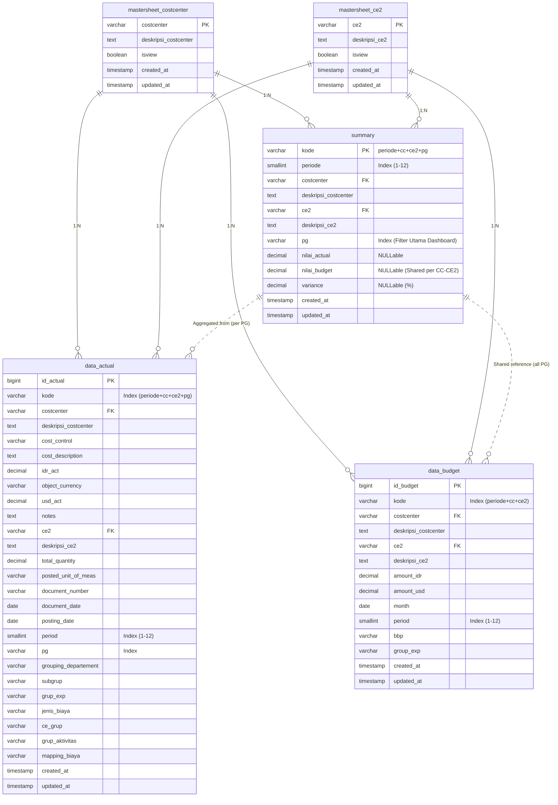

# Analisis & Perancangan Skema Database OPEX GGP (Edisi Revisi Terpadu)

Dokumen ini merupakan hasil **analisis mendalam dan perancangan skema database terpadu** untuk modul **Dashboard OPEX (*Operating Expenditure*) Great Giant Foods (GGP)**, dibangun di atas stack **Next.js, PostgreSQL, dan Prisma ORM**, dengan penyesuaian terhadap karakteristik data: **dashboard berbasis per-PG**, data Actual memiliki kolom `PG`, sedangkan data Budget **berlaku sama untuk semua PG dan tidak memiliki kolom PG pada data sumbernya**.

---

## 1. Ringkasan Eksekutif & Karakteristik Data OPEX

### Kebutuhan & Konteks Bisnis Utama:
1. **Penyajian Dashboard Selalu Per-PG**:
   - Seluruh metrik, visualisasi card, filter, dan tabel pada dashboard OPEX difokuskan pada per-Plantation Group / Purchasing Group (`PG`), bukan konsolidasi global seluruh PG.
2. **Karakteristik Asimetris Actual vs Budget**:
   - **Data Actual**: Berisi transaksi riil terperinci hingga nomor dokumen SAP (`document_number`) dan secara eksplisit memiliki identitas `PG`.
   - **Data Budget**: Merupakan alokasi plafon anggaran operasional yang diturunkan per Cost Center dan CE2 bulanan, **tanpa memiliki kolom `PG`**. Anggaran ini **berlaku sama untuk semua PG** dan **tidak boleh digandakan atau dipecah secara artifisial** menjadi budget per-PG yang berbeda.
3. **Pencegahan Penggelembungan Nilai (*Multiplication Error*)**:
   - Satu Budget dapat menjadi pembanding bagi lebih dari satu PG pada kombinasi `(periode, costcenter, ce2)` yang sama. Namun, saat dashboard melakukan agregasi total budget lintas PG (jika ada tampilan konsolidasi), nilai budget tidak boleh dijumlahkan berkali-kali (*no double counting*).

---

## 2. Analisis 12 Poin Kebutuhan Desain Database

### Poin 1: Rekomendasi Struktur Final Kelima Tabel

Database terdiri dari 5 tabel pada schema `opex`:
1. `mastersheet_costcenter`: Master daftar Cost Center unik.
2. `mastersheet_ce2`: Master daftar Cost Element 2 (CE2) unik.
3. `data_actual`: Transaksi pengeluaran aktual individual (detail level dokumen transaksi).
4. `data_budget`: Alokasi anggaran bulanan per Cost Center & CE2 (tanpa kolom PG).
5. `summary`: Tabel ringkasan agregasi per kombinasi `(periode, costcenter, ce2, PG)` lengkap dengan `nilai_actual`, `nilai_budget`, dan `variance`.

---

### Poin 2: Tipe Data PostgreSQL yang Sesuai untuk Setiap Kolom

#### A. Tabel `mastersheet_costcenter`
| Kolom | Tipe PostgreSQL | Nullable | Default | Keterangan |
|:---|:---|:---|:---|:---|
| `costcenter` | `VARCHAR(50)` | `NOT NULL` | - | Primary Key kode Cost Center unik |
| `deskripsi_costcenter` | `TEXT` | `NULL` | `NULL` | Deskripsi nama Cost Center |
| `isview` | `BOOLEAN` | `NOT NULL` | `TRUE` | Flag visibilitas dashboard |
| `created_at` | `TIMESTAMP(3)` | `NOT NULL` | `CURRENT_TIMESTAMP` | Waktu dibuat |
| `updated_at` | `TIMESTAMP(3)` | `NOT NULL` | `CURRENT_TIMESTAMP` | Waktu diperbarui |

#### B. Tabel `mastersheet_ce2`
| Kolom | Tipe PostgreSQL | Nullable | Default | Keterangan |
|:---|:---|:---|:---|:---|
| `ce2` | `VARCHAR(50)` | `NOT NULL` | - | Primary Key kode CE2 unik |
| `deskripsi_ce2` | `TEXT` | `NULL` | `NULL` | Deskripsi CE2 |
| `isview` | `BOOLEAN` | `NOT NULL` | `TRUE` | Flag visibilitas dashboard |
| `created_at` | `TIMESTAMP(3)` | `NOT NULL` | `CURRENT_TIMESTAMP` | Waktu dibuat |
| `updated_at` | `TIMESTAMP(3)` | `NOT NULL` | `CURRENT_TIMESTAMP` | Waktu diperbarui |

#### C. Tabel `data_actual`
| Kolom | Tipe PostgreSQL | Nullable | Keterangan & Karakteristik Data |
|:---|:---|:---|:---|
| `id_actual` | `BIGSERIAL` | `NOT NULL` | Primary Key auto-increment |
| `kode` | `VARCHAR(100)` | `NOT NULL` | Kode gabungan transaksi (`periode + costcenter + ce2 + PG`) |
| `costcenter` | `VARCHAR(50)` | `NULL` | Foreign Key ke `mastersheet_costcenter(costcenter)` |
| `deskripsi_costcenter` | `TEXT` | `NULL` | Deskripsi Cost Center sumber |
| `cost_control` | `VARCHAR(50)` | `NULL` | Kode Cost Control / Cost Element |
| `cost_description` | `TEXT` | `NULL` | Deskripsi akun biaya |
| `idr_act` | `DECIMAL(18, 2)` | `NULL` | Nominal transaksi IDR (kolom `IDR-Act`) |
| `object_currency` | `VARCHAR(10)` | `NULL` | Mata uang transaksi (`IDR`/`USD`) |
| `usd_act` | `DECIMAL(18, 2)` | `NULL` | Nominal transaksi USD (kolom `USD-Act`) |
| `notes` | `TEXT` | `NULL` | Catatan transaksi |
| `ce2` | `VARCHAR(50)` | `NULL` | Foreign Key ke `mastersheet_ce2(ce2)` |
| `deskripsi_ce2` | `TEXT` | `NULL` | Deskripsi CE2 |
| `total_quantity` | `DECIMAL(15, 4)` | `NULL` | Kuantitas barang / jasa dengan presisi desimal 4 |
| `posted_unit_of_meas` | `VARCHAR(20)` | `NULL` | Satuan unit (UoM) |
| `document_number` | `VARCHAR(50)` | `NULL` | Nomor referensi dokumen akuntansi SAP/ERP |
| `document_date` | `DATE` | `NULL` | Tanggal dokumen |
| `posting_date` | `DATE` | `NULL` | Tanggal posting jurnal |
| `period` | `SMALLINT` | `NULL` | Angka bulan 1–12 (integer hemat memori 2-byte) |
| `pg` | `VARCHAR(50)` | `NULL` | Kode Plantation Group / Purchasing Group |
| `grouping_departement` | `VARCHAR(100)` | `NULL` | Pengelompokan departemen |
| `subgrup` | `VARCHAR(100)` | `NULL` | Klasifikasi subgrup |
| `grup_exp` | `VARCHAR(100)` | `NULL` | Expense group |
| `jenis_biaya` | `VARCHAR(100)` | `NULL` | Klasifikasi jenis biaya |
| `ce_grup` | `VARCHAR(100)` | `NULL` | Klasifikasi grup Cost Element |
| `grup_aktivitas` | `VARCHAR(100)` | `NULL` | Klasifikasi aktivitas |
| `mapping_biaya` | `VARCHAR(100)` | `NULL` | Pemetaan biaya internal |
| `created_at` | `TIMESTAMP(3)` | `NOT NULL` | Default `CURRENT_TIMESTAMP` |
| `updated_at` | `TIMESTAMP(3)` | `NOT NULL` | Default `CURRENT_TIMESTAMP` |

#### D. Tabel `data_budget`
| Kolom | Tipe PostgreSQL | Nullable | Keterangan & Karakteristik Data |
|:---|:---|:---|:---|
| `id_budget` | `BIGSERIAL` | `NOT NULL` | Primary Key auto-increment |
| `kode` | `VARCHAR(100)` | `NOT NULL` | Kode identifikasi Budget (`periode + costcenter + ce2`) |
| `costcenter` | `VARCHAR(50)` | `NULL` | Foreign Key ke `mastersheet_costcenter(costcenter)` |
| `deskripsi_costcenter` | `TEXT` | `NULL` | Deskripsi Cost Center sumber |
| `ce2` | `VARCHAR(50)` | `NULL` | Foreign Key ke `mastersheet_ce2(ce2)` |
| `deskripsi_ce2` | `TEXT` | `NULL` | Deskripsi CE2 sumber |
| `amount_idr` | `DECIMAL(18, 2)` | `NULL` | Alokasi anggaran IDR |
| `amount_usd` | `DECIMAL(18, 2)` | `NULL` | Alokasi anggaran USD |
| `month` | `DATE` | `NULL` | Tanggal bulan asli dari Excel |
| `period` | `SMALLINT` | `NULL` | Angka bulan 1–12 hasil normalisasi |
| `bbp` | `VARCHAR(50)` | `NULL` | Kode BBP |
| `group_exp` | `VARCHAR(100)` | `NULL` | Klasifikasi grup pengeluaran |
| `created_at` | `TIMESTAMP(3)` | `NOT NULL` | Default `CURRENT_TIMESTAMP` |
| `updated_at` | `TIMESTAMP(3)` | `NOT NULL` | Default `CURRENT_TIMESTAMP` |

> [!NOTE]
> Sesuai aturan bisnis revisi, pada tabel `data_budget` **tidak terdapat kolom `pg`** karena anggaran berlaku sama untuk semua PG.

#### E. Tabel `summary`
| Kolom | Tipe PostgreSQL | Nullable | Keterangan & Rumus |
|:---|:---|:---|:---|
| `kode` | `VARCHAR(100)` | `NOT NULL` | **Primary Key**: `periode + costcenter + ce2 + PG` |
| `periode` | `SMALLINT` | `NOT NULL` | Angka bulan 1–12 |
| `costcenter` | `VARCHAR(50)` | `NULL` | Foreign Key ke `mastersheet_costcenter(costcenter)` |
| `deskripsi_costcenter` | `TEXT` | `NULL` | Deskripsi Cost Center |
| `ce2` | `VARCHAR(50)` | `NULL` | Foreign Key ke `mastersheet_ce2(ce2)` |
| `deskripsi_ce2` | `TEXT` | `NULL` | Deskripsi CE2 |
| `pg` | `VARCHAR(50)` | `NOT NULL` | Kode Plantation Group entitas dashboard |
| `nilai_actual` | `DECIMAL(18, 2)` | `NULL` | Total IDR Actual transaksi pada PG tersebut (NULL jika tidak ada transaksi) |
| `nilai_budget` | `DECIMAL(18, 2)` | `NULL` | Alokasi IDR Budget per `(periode, costcenter, ce2)` (NULL jika tidak ada anggaran) |
| `variance` | `DECIMAL(10, 2)` | `NULL` | Varians numerik (%): `((actual - budget)/budget)*100` (NULL jika budget 0/NULL/actual NULL) |
| `created_at` | `TIMESTAMP(3)` | `NOT NULL` | Default `CURRENT_TIMESTAMP` |
| `updated_at` | `TIMESTAMP(3)` | `NOT NULL` | Default `CURRENT_TIMESTAMP` |

---

### Poin 3: Primary Key, Unique Constraint, Foreign Key, dan Indeks

1. **Primary Key**:
   - `mastersheet_costcenter` $\rightarrow$ `costcenter`
   - `mastersheet_ce2` $\rightarrow$ `ce2`
   - `data_actual` $\rightarrow$ `id_actual` (BIGSERIAL auto-increment)
   - `data_budget` $\rightarrow$ `id_budget` (BIGSERIAL auto-increment)
   - `summary` $\rightarrow$ `kode` (`periode + costcenter + ce2 + PG`)
2. **Unique Constraint**:
   - `summary` $\rightarrow$ `UNIQUE(periode, costcenter, ce2, pg)` untuk menjamin integritas multi-kolom tidak pernah terduplikasi.
3. **Foreign Keys**:
   - `data_actual.costcenter` $\rightarrow$ `mastersheet_costcenter(costcenter)` (`ON UPDATE CASCADE ON DELETE RESTRICT`)
   - `data_actual.ce2` $\rightarrow$ `mastersheet_ce2(ce2)` (`ON UPDATE CASCADE ON DELETE RESTRICT`)
   - `data_budget.costcenter` $\rightarrow$ `mastersheet_costcenter(costcenter)` (`ON UPDATE CASCADE ON DELETE RESTRICT`)
   - `data_budget.ce2` $\rightarrow$ `mastersheet_ce2(ce2)` (`ON UPDATE CASCADE ON DELETE RESTRICT`)
   - `summary.costcenter` $\rightarrow$ `mastersheet_costcenter(costcenter)` (`ON UPDATE CASCADE ON DELETE RESTRICT`)
   - `summary.ce2` $\rightarrow$ `mastersheet_ce2(ce2)` (`ON UPDATE CASCADE ON DELETE RESTRICT`)
   - **Evaluasi Physical FK pada `kode`**: Tidak digunakan antara tabel transaksi dan `summary`. Hubungan bersifat logis dengan dukungan indeks B-tree agar tidak memblokir alur ingesti data (*decoupled pipeline*).
4. **Indeks Performa Tinggi**:
   - `summary`: `(pg)`, `(periode)`, `(costcenter)`, `(ce2)`, dan composite `(pg, periode, costcenter, ce2)`.
   - `data_actual`: `(kode)`, `(period)`, `(costcenter)`, `(ce2)`, `(pg)`.
   - `data_budget`: `(kode)`, `(period)`, `(costcenter)`, `(ce2)`.

---

### Poin 4 & 5: Validasi Keunikan & Strategi Pembentukan `kode` Summary

#### Rumus Pembentukan Kode Summary:
$$\text{kode} = \text{TRIM}(\text{periode}) + \text{TRIM}(\text{costcenter}) + \text{TRIM}(\text{ce2}) + \text{TRIM}(\text{PG})$$

#### Analisis Pemisah (*Separator*) vs Sambung Langsung:
- Jika tanpa separator: Contoh `1` + `CC10` + `CE01` + `PG1` $\rightarrow$ `1CC10CE01PG1`.
- Karakteristik data SAP GGP:
  - `periode`: Angka 1 digit atau 2 digit (`1` s.d. `12`).
  - `costcenter`: Kode alfanumerik standar (misal `CC100`, `100120`).
  - `ce2`: Kode alfanumerik standar (misal `CE01`, `512000`).
  - `pg`: Kode Plantation Group (misal `PG1`, `PG2`, `PG3`).
- **Rekomendasi Format**:
  Untuk menghindari risiko ambiguitas (misal periode 11 dengan CC 1 vs periode 1 dengan CC 11), format yang digunakan dapat tetap berupa sambungan string tanpa separator sesuai contoh permintaan user (`1CC100CE01PG1`, `1CC100CE01PG2`), asalkan pada level database diterapkan **`UNIQUE(periode, costcenter, ce2, pg)`** sebagai pengaman ganda (*safety belt*).
- Seluruh teks wajib di-`TRIM()` dan diubah ke huruf kapital (`UPPERCASE`) untuk mencegah duplikasi akibat spasi atau huruf kecil.

---

### Poin 6: Strategi Agregasi Actual dan Budget (Tanpa Duplikasi)

Granularitas Actual dan Budget berbeda signifikan:
- **Actual**: Banyak transaksi per baris.
- **Budget**: Plafon per bulan, Cost Center, dan CE2.

Jika dilakukan `JOIN` langsung:
```sql
-- DILARANG: Memicu Cartesian Product!
SELECT * FROM data_actual a JOIN data_budget b ON a.kode = b.kode;
```
Akan melipatgandakan nilai budget sebanyak jumlah transaksi actual!

#### Solusi Dua Tahap (*Independent Pre-Aggregation CTE*):
1. **Langkah 1**: Agregasikan `data_actual` per kombinasi `(period, costcenter, ce2, pg)`.
2. **Langkah 2**: Agregasikan `data_budget` per kombinasi `(period, costcenter, ce2)`.
3. **Langkah 3**: Gabungkan hasil langkah 1 dan 2 berdasarkan `(period, costcenter, ce2)` untuk setiap `PG`.

---

### Poin 7 & 9: Strategi Penyimpanan, Perhitungan `variance`, dan Penanganan NULL

#### Rumus Varians Persentase:
$$\text{variance} = \left(\frac{\text{nilai\_actual} - \text{nilai\_budget}}{\text{nilai\_budget}}\right) \times 100$$

#### Ketentuan Teknis Penyimpanan:
- Disimpan sebagai tipe numerik `DECIMAL(10, 2)` (menyimpan nilai angka murni seperti `20.00` atau `-12.50`, bukan string dengan simbol `%`).
- Penambahan simbol `%` dan format regional (misal `12,50%`) dilakukan di level komponen UI frontend Next.js.

#### Matriks Penanganan Kasus Khusus & Nilai Nol/NULL:
| Kondisi Actual | Kondisi Budget | Nilai Actual | Nilai Budget | Nilai Variance | Keterangan Bisnis |
|:---|:---|:---|:---|:---|:---|
| Transaksi ada | Anggaran ada | `120000000.00` | `100000000.00` | `+20.00` | *Over-budget* sebesar 20% |
| Transaksi ada | Anggaran ada | `80000000.00` | `100000000.00` | `-20.00` | *Under-budget* (efisiensi) sebesar 20% |
| Transaksi ada | Anggaran ada | `100000000.00` | `100000000.00` | `0.00` | Realisasi tepat sesuai target anggaran |
| **Tidak ada transaksi** | Anggaran ada | `NULL` | `50000000.00` | `NULL` | Belum ada realisasi (tampilan dashboard: `-`) |
| Transaksi ada | **Tidak ada anggaran** | `30000000.00` | `NULL` | `NULL` | Pengeluaran tanpa anggaran (variance tidak terdefinisi) |
| Transaksi tercatat Rp 0 | Anggaran ada | `0.00` | `50000000.00` | `-100.00` | Realisasi Rp 0, efisiensi 100% |
| Transaksi ada | **Anggaran bernilai Rp 0** | `25000000.00` | `0.00` | `NULL` | **Aman dari Division by Zero** (divisi dengan 0 menghasilkan `NULL`) |
| **Tidak ada keduanya** | **Tidak ada keduanya** | `NULL` | `NULL` | `NULL` | Baris tidak dimasukkan ke summary |

---

### Poin 8: Penanganan Budget yang Berlaku untuk Semua PG

Ini adalah aspek paling krusial dari perancangan:
1. **Bagaimana Budget Dipetakan ke Baris Summary per PG?**
   - Di tabel `summary`, setiap baris mewakili 1 PG (`periode + costcenter + ce2 + PG`).
   - Jika `PG1` dan `PG2` sama-sama memiliki transaksi actual pada `Periode 1, CC100, CE01`, maka:
     - Baris Summary `PG1`: `nilai_budget` mengambil total budget `(Periode 1, CC100, CE01)`.
     - Baris Summary `PG2`: `nilai_budget` juga mengambil total budget `(Periode 1, CC100, CE01)`.
   - Hal ini memenuhi aturan: **"Satu nilai Budget berlaku untuk semua PG. Nilai Budget yang sama boleh menjadi referensi pada beberapa baris Summary untuk PG yang berbeda"**.
2. **Bagaimana jika suatu Budget memiliki alokasi, tetapi pada periode tersebut BELUM ADA transaksi Actual dari PG manapun?**
   - **Tantangan**: Karena file Budget tidak punya kolom `PG`, ke PG manakah baris Budget ini harus ditempelkan di Summary jika belum ada transaksi di Actual?
   - **Analisis & Rekomendasi Solusi**:
     - *Solusi A (Daftar Master PG Aktif)*: Sistem mengambil daftar seluruh PG unik yang ada di master/transaksi tahun berjalan (misal: `PG1`, `PG2`, `PG3`). Untuk setiap budget yang belum ada transaksi actual, baris summary dapat direlasikan ke PG relevan yang mengoperasikan Cost Center tersebut.
     - *Solusi B (Hanya PG yang Memiliki Realisasi)*: Baris summary hanya dibentuk untuk PG yang memiliki transaksi actual, sedangkan budget tanpa actual disajikan di baris umum atau seluruh PG terdaftar.
     - **Rekomendasi Terbaik**: Gunakan daftar `PG` yang beroperasi pada Cost Center tersebut (Cross Join `mastersheet_pg` atau `DISTINCT pg` dari `data_actual`), sehingga saat user membuka dashboard untuk `PG1`, plafon anggaran tetap terlihat meskipun realisasi belum ada (`nilai_actual = NULL`, `nilai_budget = 100.000.000`, `variance = NULL`).

---

### Poin 10: Rekomendasi: Tabel Fisik vs Database View vs Materialized View

| Parameter | Database View Biasa (`VIEW`) | Materialized View (`MATERIALIZED VIEW`) | Tabel Fisik `summary` (**Rekomendasi Terpilih**) |
|:---|:---|:---|:---|
| **Kecepatan Dashboard (<50ms)** | ❌ Lambat (hitung ulang CTE & Outer Join setiap request) | ✅ Cepat setelah di-refresh | 🚀 **Sangat Cepat & Responsif** |
| **Kompatibilitas Prisma ORM** | ⚠️ Read-only, tidak ada typed mutation | ⚠️ Prisma tidak mendukung migrasi natif materialized view | 💯 **Didukung Penuh** oleh Prisma (lengkap dengan relasi model & indexing) |
| **Indexing Tambahan** | ❌ Tidak bisa diindeks langsung | ✅ Bisa dengan `CONCURRENTLY` | ✅ **Bebas membuat composite B-Tree index** |
| **Pola Pembaruan Data** | Realtime | Perlu trigger `REFRESH MATERIALIZED VIEW` | **Atomik saat upload file Excel tahunan** via `prisma.$transaction` |

> [!TIP]
> **Keputusan**: Gunakan **Tabel Fisik `summary`**. Karena data OPEX diperbarui secara berkala (bulanan/tahunan via impor Excel), tabel fisik yang di-regenerate dalam transaksi atomik memberikan performa pembacaan tercepat tanpa overhead server database.

---

### Poin 11: Potensi Masalah Data, Inkonsistensi Periode, & Solusi Pencegahan

1. **Inkonsistensi Format Tanggal `month` pada Excel Budget**:
   - Kolom `month` pada Excel seringkali berisi format teks campuran (misal: `"Jan 2026"`, `"2026-01-01"`, serial number Excel `45300`, atau nama bulan Indonesia `"Januari"`).
   - *Solusi*: Parser impor harus memiliki fungsi parsing tanggal deterministik yang mengonversi tanggal/bulan apapun menjadi integer `1` s.d. `12`.
2. **Ketiadaan Transaksi Actual vs Duplikasi Anggaran**:
   - Jika satu budget dibaca oleh 3 PG berbeda pada dashboard konsolidasi, `SUM(nilai_budget)` lintas PG akan berlipat ganda 3 kali.
   - *Solusi*: Sesuai aturan bisnis nomor 1, **"Dashboard selalu menampilkan data per PG, bukan gabungan seluruh PG"**. Jika di masa depan dibutuhkan summary total seluruh PG, query dashboard harus melakukan `DISTINCT` atau membaca langsung dari `data_budget`.
3. **Spasi dan Perbedaan Huruf Kapital**:
   - Karakter tersembunyi pada `costcenter` (misal `"CC100 "` vs `"CC100"`) akan menyebabkan kegagalan pencocokan kode.
   - *Solusi*: Normalisasi ketat `TRIM(UPPER(kolom))` pada tahap staging sebelum insert ke database.

---

### Poin 12: Rekomendasi Perubahan dari Skema Saat Ini

Berdasarkan aturan bisnis baru, berikut penyesuaian yang diterapkan dari skema sebelumnya:
1. **Penghapusan Kolom `pg` dari `data_budget`**:
   - Pada skema awal, kolom `pg` sempat disiapkan di `data_budget`.
   - **Perubahan**: Sesuai instruksi user bahwa data Budget sumber tidak memiliki kolom PG dan berlaku untuk semua PG, maka kolom `pg` pada `data_budget` **dihapus** dari tabel sumber budget. Kunci agregasi budget murni menggunakan `(period, costcenter, ce2)`.
2. **Kode Budget vs Kode Summary**:
   - `data_actual.kode` $\rightarrow$ `periode + costcenter + ce2 + PG` (karena actual memiliki PG).
   - `data_budget.kode` $\rightarrow$ `periode + costcenter + ce2` (karena budget berlaku untuk semua PG).
   - `summary.kode` $\rightarrow$ `periode + costcenter + ce2 + PG` (karena summary disajikan per-PG).
3. **Query Agregasi Summary yang Baru**:
   - `data_budget` di-join ke hasil agregasi `data_actual` menggunakan kunci `(period, costcenter, ce2)`.

---

## 3. Query Agregasi Pembentukan Tabel Summary (SQL)

Berikut adalah query resmi untuk membentuk data `summary` per-PG secara aman dan presisi:

```sql
WITH agg_actual AS (
    -- Agregasi seluruh transaksi actual per periode, costcenter, ce2, dan PG
    SELECT 
        period AS periode,
        TRIM(UPPER(costcenter)) AS costcenter,
        MAX(deskripsi_costcenter) AS deskripsi_costcenter,
        TRIM(UPPER(ce2)) AS ce2,
        MAX(deskripsi_ce2) AS deskripsi_ce2,
        TRIM(UPPER(pg)) AS pg,
        SUM(idr_act) AS nilai_actual
    FROM opex.data_actual
    WHERE period IS NOT NULL 
      AND costcenter IS NOT NULL 
      AND ce2 IS NOT NULL 
      AND pg IS NOT NULL
    GROUP BY period, TRIM(UPPER(costcenter)), TRIM(UPPER(ce2)), TRIM(UPPER(pg))
),
agg_budget AS (
    -- Agregasi alokasi budget per periode, costcenter, dan ce2 (berlaku untuk semua PG)
    SELECT 
        period AS periode,
        TRIM(UPPER(costcenter)) AS costcenter,
        MAX(deskripsi_costcenter) AS deskripsi_costcenter,
        TRIM(UPPER(ce2)) AS ce2,
        MAX(deskripsi_ce2) AS deskripsi_ce2,
        SUM(amount_idr) AS nilai_budget
    FROM opex.data_budget
    WHERE period IS NOT NULL 
      AND costcenter IS NOT NULL 
      AND ce2 IS NOT NULL
    GROUP BY period, TRIM(UPPER(costcenter)), TRIM(UPPER(ce2))
)
-- Penggabungan Actual dan Budget ke dalam Summary per PG
SELECT 
    -- Pembentukan Primary Key Kode Unik: periode + costcenter + ce2 + PG
    CONCAT(a.periode, a.costcenter, a.ce2, a.pg) AS kode,
    a.periode,
    a.costcenter,
    COALESCE(a.deskripsi_costcenter, b.deskripsi_costcenter) AS deskripsi_costcenter,
    a.ce2,
    COALESCE(a.deskripsi_ce2, b.deskripsi_ce2) AS deskripsi_ce2,
    a.pg,
    a.nilai_actual,
    b.nilai_budget,
    -- Perhitungan Varians Persentase dengan Proteksi Division by Zero & NULL
    CASE 
        WHEN b.nilai_budget IS NULL OR b.nilai_budget = 0 OR a.nilai_actual IS NULL THEN NULL
        ELSE ROUND(((a.nilai_actual - b.nilai_budget) / b.nilai_budget) * 100, 2)
    END AS variance,
    CURRENT_TIMESTAMP AS created_at,
    CURRENT_TIMESTAMP AS updated_at
FROM agg_actual a
LEFT JOIN agg_budget b 
    ON a.periode = b.periode 
   AND a.costcenter = b.costcenter 
   AND a.ce2 = b.ce2;
```

---

## 4. Entity Relationship Diagram (ERD) Terkini



---

## 5. Implementasi Schema Prisma Terpadu (`schema.prisma`)

```prisma
// Prisma Schema for Dashboard OPEX (Operating Expenditure) - Great Giant Foods (GGP)
// Sesuai panduan perancangan: doc/skema_database_opex_ggp.md

generator client {
  provider = "prisma-client-js"
  output   = "../src/generated/client"
}

datasource db {
  provider = "postgresql"
  url      = env("DATABASE_URL")
}

// ─────────────────────────────────────────────────────────────────────────────
// 1. TABEL MASTER
// ─────────────────────────────────────────────────────────────────────────────

/// Master daftar Cost Center unik dari kolom Summary file Excel sumber
model MastersheetCostcenter {
  costcenter          String   @id @map("costcenter")
  deskripsiCostcenter String?  @map("deskripsi_costcenter")
  isview              Boolean  @default(true) @map("isview") // Mengatur visibilitas dashboard tanpa menghapus data

  createdAt           DateTime @default(now()) @map("created_at")
  updatedAt           DateTime @updatedAt @map("updated_at")

  // Relasi 1:N ke Data Transaksi & Summary
  dataActualList      DataActual[]
  dataBudgetList      DataBudget[]
  summaryList         Summary[]

  @@map("mastersheet_costcenter")
}

/// Master daftar Cost Element 2 (CE2) unik dari kolom Summary file Excel sumber
model MastersheetCe2 {
  ce2          String   @id @map("ce2")
  deskripsiCe2 String?  @map("deskripsi_ce2")
  isview       Boolean  @default(true) @map("isview") // Mengatur visibilitas dashboard tanpa menghapus data

  createdAt    DateTime @default(now()) @map("created_at")
  updatedAt    DateTime @updatedAt @map("updated_at")

  // Relasi 1:N ke Data Transaksi & Summary
  dataActualList DataActual[]
  dataBudgetList DataBudget[]
  summaryList    Summary[]

  @@map("mastersheet_ce2")
}

// ─────────────────────────────────────────────────────────────────────────────
// 2. TABEL TRANSAKSI (DATA SOURCE)
// ─────────────────────────────────────────────────────────────────────────────

/// Data realisasi/aktual biaya OPEX dari file Excel sumber (memiliki kolom PG)
model DataActual {
  idActual            BigInt    @id @default(autoincrement()) @map("id_actual")
  kode                String    @map("kode") // Kode gabungan: periode + costcenter + ce2 + pg
  costcenter          String?   @map("costcenter")
  deskripsiCostcenter String?   @map("deskripsi_costcenter")
  costControl         String?   @map("cost_control") // Kolom cost_control / cost_element
  costDescription     String?   @map("cost_description")
  idrAct              Decimal?  @map("idr_act") @db.Decimal(18, 2) // Kolom IDR-Act pada Excel
  objectCurrency      String?   @map("object_currency") @db.VarChar(10)
  usdAct              Decimal?  @map("usd_act") @db.Decimal(18, 2) // Kolom USD-Act pada Excel
  notes               String?   @map("notes")
  ce2                 String?   @map("ce2")
  deskripsiCe2        String?   @map("deskripsi_ce2")
  totalQuantity       Decimal?  @map("total_quantity") @db.Decimal(15, 4)
  postedUnitOfMeas    String?   @map("posted_unit_of_meas") @db.VarChar(20)
  documentNumber      String?   @map("document_number") @db.VarChar(50)
  documentDate        DateTime? @map("document_date") @db.Date
  postingDate         DateTime? @map("posting_date") @db.Date
  period              Int?      @map("period") @db.SmallInt // Dinormalisasi angka bulan 1–12
  pg                  String?   @map("pg") @db.VarChar(50) // Plantation Group / Purchasing Group
  groupingDepartement String?   @map("grouping_departement") @db.VarChar(100)
  subgrup             String?   @map("subgrup") @db.VarChar(100)
  grupExp             String?   @map("grup_exp") @db.VarChar(100)
  jenisBiaya          String?   @map("jenis_biaya") @db.VarChar(100)
  ceGrup              String?   @map("ce_grup") @db.VarChar(100)
  grupAktivitas       String?   @map("grup_aktivitas") @db.VarChar(100)
  mappingBiaya        String?   @map("mapping_biaya") @db.VarChar(100)

  createdAt           DateTime  @default(now()) @map("created_at")
  updatedAt           DateTime  @updatedAt @map("updated_at")

  // Relasi ke Master (N:1)
  costcenterRef       MastersheetCostcenter? @relation(fields: [costcenter], references: [costcenter], onDelete: Restrict, onUpdate: Cascade)
  ce2Ref              MastersheetCe2?        @relation(fields: [ce2], references: [ce2], onDelete: Restrict, onUpdate: Cascade)

  // Indeks untuk query agregasi dan filtering
  @@index([kode])
  @@index([period])
  @@index([costcenter])
  @@index([ce2])
  @@index([pg])
  @@map("data_actual")
}

/// Data anggaran biaya OPEX dari file Excel sumber (tanpa kolom PG, berlaku untuk semua PG)
model DataBudget {
  idBudget            BigInt    @id @default(autoincrement()) @map("id_budget")
  kode                String    @map("kode") // Kode gabungan: periode + costcenter + ce2
  costcenter          String?   @map("costcenter")
  deskripsiCostcenter String?   @map("deskripsi_costcenter")
  ce2                 String?   @map("ce2")
  deskripsiCe2        String?   @map("deskripsi_ce2")
  amountIdr           Decimal?  @map("amount_idr") @db.Decimal(18, 2)
  amountUsd           Decimal?  @map("amount_usd") @db.Decimal(18, 2)
  month               DateTime? @map("month") @db.Date // Periode sumber dalam format tanggal
  period              Int?      @map("period") @db.SmallInt // Angka bulan 1–12 untuk penyusunan kode & summary
  bbp                 String?   @map("bbp") @db.VarChar(50)
  groupExp            String?   @map("group_exp") @db.VarChar(100)

  createdAt           DateTime  @default(now()) @map("created_at")
  updatedAt           DateTime  @updatedAt @map("updated_at")

  // Relasi ke Master (N:1)
  costcenterRef       MastersheetCostcenter? @relation(fields: [costcenter], references: [costcenter], onDelete: Restrict, onUpdate: Cascade)
  ce2Ref              MastersheetCe2?        @relation(fields: [ce2], references: [ce2], onDelete: Restrict, onUpdate: Cascade)

  // Indeks untuk query agregasi dan filtering
  @@index([kode])
  @@index([period])
  @@index([costcenter])
  @@index([ce2])
  @@map("data_budget")
}

// ─────────────────────────────────────────────────────────────────────────────
// 3. TABEL SUMMARY (HASIL AGREGASI ACTUAL & BUDGET PER PG)
// ─────────────────────────────────────────────────────────────────────────────

/// Ringkasan hasil agregasi Actual & Budget per PG (kode = periode + costcenter + ce2 + pg)
model Summary {
  kode                String    @id @map("kode") // Primary key unik gabungan (periode + costcenter + ce2 + pg)
  periode             Int       @map("periode") @db.SmallInt // Angka bulan 1–12
  costcenter          String?   @map("costcenter")
  deskripsiCostcenter String?   @map("deskripsi_costcenter")
  ce2                 String?   @map("ce2")
  deskripsiCe2        String?   @map("deskripsi_ce2")
  pg                  String    @map("pg") @db.VarChar(50) // Plantation Group (kunci filter dashboard)
  nilaiActual         Decimal?  @map("nilai_actual") @db.Decimal(18, 2) // NULL jika tidak ada transaksi actual pada PG tersebut
  nilaiBudget         Decimal?  @map("nilai_budget") @db.Decimal(18, 2) // Nilai budget yang berlaku sama untuk kombinasi CC & CE2
  variance            Decimal?  @map("variance") @db.Decimal(10, 2) // Persentase varians: ((nilai_actual - nilai_budget) / nilai_budget) * 100

  createdAt           DateTime  @default(now()) @map("created_at")
  updatedAt           DateTime  @updatedAt @map("updated_at")

  // Relasi ke Master (N:1)
  costcenterRef       MastersheetCostcenter? @relation(fields: [costcenter], references: [costcenter], onDelete: Restrict, onUpdate: Cascade)
  ce2Ref              MastersheetCe2?        @relation(fields: [ce2], references: [ce2], onDelete: Restrict, onUpdate: Cascade)

  // Constraint Unik & Indeks Performa Dashboard
  @@unique([periode, costcenter, ce2, pg])
  @@index([pg])
  @@index([periode])
  @@index([costcenter])
  @@index([ce2])
  @@index([pg, periode, costcenter, ce2])
  @@map("summary")
}
```

---

## 6. DDL Murni PostgreSQL

```sql
CREATE SCHEMA IF NOT EXISTS opex;

-- 1. Mastersheet Cost Center
CREATE TABLE opex.mastersheet_costcenter (
    costcenter VARCHAR(50) PRIMARY KEY,
    deskripsi_costcenter TEXT,
    isview BOOLEAN NOT NULL DEFAULT TRUE,
    created_at TIMESTAMP(3) NOT NULL DEFAULT CURRENT_TIMESTAMP,
    updated_at TIMESTAMP(3) NOT NULL DEFAULT CURRENT_TIMESTAMP
);

-- 2. Mastersheet CE2
CREATE TABLE opex.mastersheet_ce2 (
    ce2 VARCHAR(50) PRIMARY KEY,
    deskripsi_ce2 TEXT,
    isview BOOLEAN NOT NULL DEFAULT TRUE,
    created_at TIMESTAMP(3) NOT NULL DEFAULT CURRENT_TIMESTAMP,
    updated_at TIMESTAMP(3) NOT NULL DEFAULT CURRENT_TIMESTAMP
);

-- 3. Data Actual (Memiliki Kolom PG)
CREATE TABLE opex.data_actual (
    id_actual BIGSERIAL PRIMARY KEY,
    kode VARCHAR(100) NOT NULL,
    costcenter VARCHAR(50) REFERENCES opex.mastersheet_costcenter(costcenter) ON UPDATE CASCADE ON DELETE RESTRICT,
    deskripsi_costcenter TEXT,
    cost_control VARCHAR(50),
    cost_description TEXT,
    idr_act DECIMAL(18, 2),
    object_currency VARCHAR(10),
    usd_act DECIMAL(18, 2),
    notes TEXT,
    ce2 VARCHAR(50) REFERENCES opex.mastersheet_ce2(ce2) ON UPDATE CASCADE ON DELETE RESTRICT,
    deskripsi_ce2 TEXT,
    total_quantity DECIMAL(15, 4),
    posted_unit_of_meas VARCHAR(20),
    document_number VARCHAR(50),
    document_date DATE,
    posting_date DATE,
    period SMALLINT,
    pg VARCHAR(50),
    grouping_departement VARCHAR(100),
    subgrup VARCHAR(100),
    grup_exp VARCHAR(100),
    jenis_biaya VARCHAR(100),
    ce_grup VARCHAR(100),
    grup_aktivitas VARCHAR(100),
    mapping_biaya VARCHAR(100),
    created_at TIMESTAMP(3) NOT NULL DEFAULT CURRENT_TIMESTAMP,
    updated_at TIMESTAMP(3) NOT NULL DEFAULT CURRENT_TIMESTAMP
);

-- 4. Data Budget (Tanpa Kolom PG, Berlaku untuk Semua PG)
CREATE TABLE opex.data_budget (
    id_budget BIGSERIAL PRIMARY KEY,
    kode VARCHAR(100) NOT NULL,
    costcenter VARCHAR(50) REFERENCES opex.mastersheet_costcenter(costcenter) ON UPDATE CASCADE ON DELETE RESTRICT,
    deskripsi_costcenter TEXT,
    ce2 VARCHAR(50) REFERENCES opex.mastersheet_ce2(ce2) ON UPDATE CASCADE ON DELETE RESTRICT,
    deskripsi_ce2 TEXT,
    amount_idr DECIMAL(18, 2),
    amount_usd DECIMAL(18, 2),
    month DATE,
    period SMALLINT,
    bbp VARCHAR(50),
    group_exp VARCHAR(100),
    created_at TIMESTAMP(3) NOT NULL DEFAULT CURRENT_TIMESTAMP,
    updated_at TIMESTAMP(3) NOT NULL DEFAULT CURRENT_TIMESTAMP
);

-- 5. Summary (Per PG)
CREATE TABLE opex.summary (
    kode VARCHAR(100) PRIMARY KEY,
    periode SMALLINT NOT NULL,
    costcenter VARCHAR(50) REFERENCES opex.mastersheet_costcenter(costcenter) ON UPDATE CASCADE ON DELETE RESTRICT,
    deskripsi_costcenter TEXT,
    ce2 VARCHAR(50) REFERENCES opex.mastersheet_ce2(ce2) ON UPDATE CASCADE ON DELETE RESTRICT,
    deskripsi_ce2 TEXT,
    pg VARCHAR(50) NOT NULL,
    nilai_actual DECIMAL(18, 2),
    nilai_budget DECIMAL(18, 2),
    variance DECIMAL(10, 2),
    created_at TIMESTAMP(3) NOT NULL DEFAULT CURRENT_TIMESTAMP,
    updated_at TIMESTAMP(3) NOT NULL DEFAULT CURRENT_TIMESTAMP,
    CONSTRAINT uq_summary_period_cc_ce2_pg UNIQUE (periode, costcenter, ce2, pg)
);

-- Indeks
CREATE INDEX idx_actual_kode ON opex.data_actual(kode);
CREATE INDEX idx_actual_period ON opex.data_actual(period);
CREATE INDEX idx_actual_costcenter ON opex.data_actual(costcenter);
CREATE INDEX idx_actual_ce2 ON opex.data_actual(ce2);
CREATE INDEX idx_actual_pg ON opex.data_actual(pg);

CREATE INDEX idx_budget_kode ON opex.data_budget(kode);
CREATE INDEX idx_budget_period ON opex.data_budget(period);
CREATE INDEX idx_budget_costcenter ON opex.data_budget(costcenter);
CREATE INDEX idx_budget_ce2 ON opex.data_budget(ce2);

CREATE INDEX idx_summary_pg ON opex.summary(pg);
CREATE INDEX idx_summary_periode ON opex.summary(periode);
CREATE INDEX idx_summary_costcenter ON opex.summary(costcenter);
CREATE INDEX idx_summary_ce2 ON opex.summary(ce2);
CREATE INDEX idx_summary_composite ON opex.summary(pg, periode, costcenter, ce2);
```
